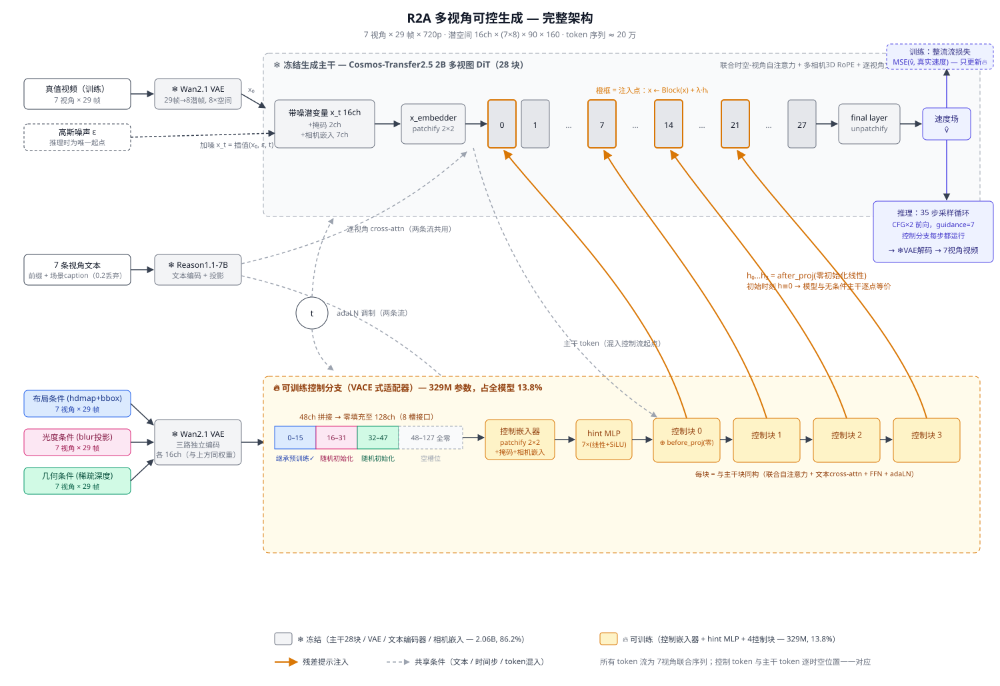

# R2V World Foundation Model

## 这个项目在做什么

**用结构化的条件信号可控地生成多视角驾驶视频。** 给定三路"示意图式"的条件视频——**布局**（高精地图+目标框渲染）、**光度**（模糊投影）、**几何**（稀疏深度）——模型生成与之对应的、以假乱真的 7 相机环视驾驶视频（29 帧、720p、10Hz）。

直观地说：条件视频告诉模型"**哪里**有车、路往**哪**拐、物体大概**长什么样**、离多**远**"，模型负责把这些约束渲染成逼真的视频。应用指向：把路侧感知/仿真轨迹等廉价信号转换成自车视角的训练数据。



## 方法：怎么做到的

**基座**：NVIDIA Cosmos-Transfer2.5-2B 多视图扩散模型（整流流 DiT，28 块）。它在大规模驾驶数据上预训练过，自带两样对我们关键的东西：
1. 一条 **VACE 式控制分支**（4 个控制块，通过零初始化投影向主干注入可加残差），预训练时只学过一种条件（hdmap_bbox）；
2. 一个 **8 槽位的通道接口**——控制输入按每路 16 通道的"槽位"拼接，预训练只占用了 1 个槽，其余留空。

**我们的做法**（三个关键决策）：

1. **往空槽里放我们的条件**。三路条件各自经冻结的 Wan2.1 VAE 编码成 16 通道潜变量，按"布局 / 光度 / 几何"的顺序填入前 3 个槽位。**布局刻意放在第一个槽**——那是预训练过的 hdmap 通路，像素统计相近（都是按类别着色的实心多边形），其语义理解能力被直接继承；光度和几何落在从未训练过的通道上，从随机初始化学起。
2. **冻结主干，只训练控制分支**。28 块主干、VAE、文本编码器全部冻结，梯度只更新控制嵌入器 + hint MLP + 4 个控制块——**329M 参数，占全模型 2.39B 的 13.8%**。这保证了预训练的生成先验（光影、质感、运动规律）零破坏，也让几十个场景的小数据集足以完成适配：数据只需要教会"条件→内容的映射"，不需要教"怎么画视频"。
3. **纯控制驱动生成**。训练时条件帧恒为 0（不给任何真值帧做提示），因为目标应用场景在推理时不存在自车观测——视频必须完全由三路条件+文本决定。

训练目标是标准的整流流速度预测损失。文本仅提供静态场景描述（以 0.2 概率丢弃以支持 classifier-free guidance），动态内容全部由条件视频控制。

**架构上没有发明新模块**——控制分支、零初始化注入、槽位接口都是基座自带的。本项目的贡献在于：条件信号的构造、先验对齐的通道分配策略、参数高效的跨域适配配方，以及下面的模态贡献分析。

## 已完成的实验与发现

### 1. 天津全量模型（主模型）

75 个路口场景训练 / 8 个场景测试，8000 步。这是目前效果最好的模型（检查点 iter_6600），后续分析都基于它。

### 2. 模态剔除分析（验证三路条件各自学到了什么）

推理时在潜空间把某一路条件置零（等价于"缺失该模态"），同一噪声种子下对比生成质量（7 测试场景 × 7 视角）：

| 设定 | PSNR↑ | SSIM↑ | LPIPS↓ | FID↓ | FVD↓ |
|---|---|---|---|---|---|
| 三路齐全 | 15.24 | 0.410 | 0.368 | 31.4 | 21.4 |
| 去掉布局 | 14.89 | 0.398 | 0.426 | **58.1** | 31.9 |
| 去掉光度 | **13.14** | **0.295** | **0.624** | 64.3 | 36.8 |
| 去掉几何 | 14.99 | 0.406 | 0.389 | 32.6 | 22.4 |
| 全部去掉 | 12.47 | 0.281 | 0.693 | 142.3 | 74.7 |

**发现：三路条件是层级互补的。**
- **光度**承载主体信息（它是真实视频的稠密退化版），剔除后全指标重创；
- **布局**的价值在**语义层**：剔除后像素指标几乎不动（位置信息与光度冗余），但 FID 翻倍——它贡献的是物体完整性、类别正确性这类分布级质量，恰好对应它继承的预训练语义能力，反过来佐证了通道分配策略；
- **几何**提供小而系统的增益（21 个片段中 20 个变差）。

### 3. 东风数据适配（跨数据集验证）

同一配方应用到一批完全不同的数据（33 次自车采集、498 个片段），从官方检查点重新训练。验证配方的可迁移性。

### 4. 天津 small（数据量实验）

10 个场景 / 400 步的缩量版，测试场景（053、077）两边模型都没见过，用于回答"这套适配到底需要多少数据"。详见 `docs/tianjin_small_run.md`。

## 与上游代码的关系

`cosmos_transfer2/_src/` 是上游 Cosmos 代码，**网络结构零改动**（全部修改仅为：条件数据类加 2 个字段、5 处 batch>1 的张量处理修复）。我们的代码集中在两处：

- `cosmos_transfer2/experiments/custom/` —— 数据集类（天津/东风/路侧三种命名规范）、训练实验配置（全量/small/东风/消融）、推理脚本（按数据各一个，外加模态剔除探针）、训练回调（测试集 loss、文本嵌入缓存）；
- `scripts/` —— 训练启动脚本、独立评测脚本（PSNR/SSIM/LPIPS/FID/FVD + 配对分析）、参数统计等工具。

## 如果要跑

全部命令和细节见各脚本顶部的 docstring 与 `docs/tianjin_small_run.md`。最简版：

```bash
# 训练（东风为例；天津 small 换 train_tianjin_small.sh）
CUDA_VISIBLE_DEVICES=0,1,2,3,4,5,6,7 NUM_GPUS=8 bash scripts/train_dongfeng_multi_control.sh

# 推理（35步采样、guidance 7，输出每样本7个视角的mp4）
torchrun --nproc_per_node=8 -m cosmos_transfer2.experiments.custom.inference \
  --experiment <实验名> --ckpt_path <检查点> --scene_ids <场景> \
  --context_parallel_size 8 --num_views 7 --output_dir <输出>

# 评测
python3 scripts/eval_dropout_matrix.py
```

硬件：8×A100-80G（一个样本约 20 万 token，8 卡 context-parallel 协同处理单样本）。数据与输出均在 a100 机器的 /mnt 与 /mnt2 上。
